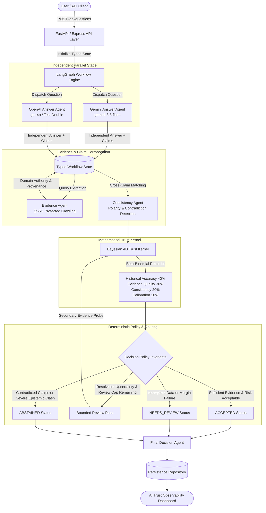
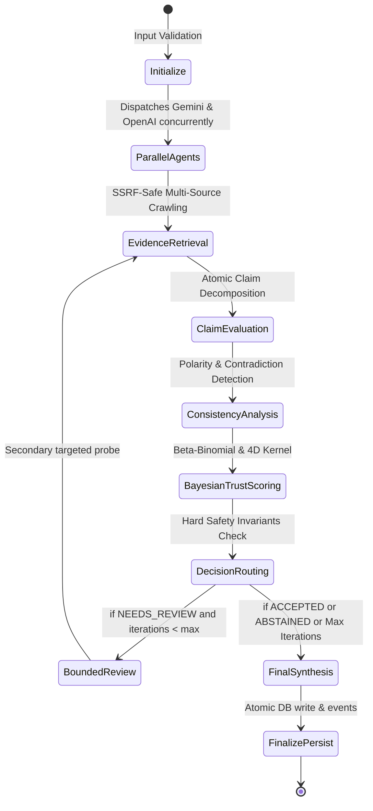

# AI Trust Architecture - System Architecture & LangGraph Design

## 1. System Overview

**AI Trust Architecture** is an AI answer verification and reliability platform designed around epistemic humility and empirical corroboration.

---

## 2. LangGraph State Machine Topology

---

## 3. Core Component Roles

1. **Gemini Answer Agent**: Real Google GenAI integration utilizing `gemini-3.8-flash` via `@google/genai`. Receives only the user query to guarantee independence.
2. **OpenAI Answer Agent**: OpenAI frontier model integration. When external credentials are unconfigured, runs in explicit deterministic test double mode (`isTestDouble: true`) without fabricated telemetry.
3. **Evidence Agent**: Multi-source evidence crawler enforcing strict CIDR, loopback, and metadata blocking (SSRF defense). Scores domain authority (NIST, NASA, CDC, WHO, Nature, Reuters).
4. **Consistency Agent**: Compares claim sets across models. Detects polar opposite claims, conflicting dates/metrics, and flags unsupported consensus.
5. **Trust Kernel**: Pure mathematical engine calculating Beta-Binomial Bayesian accuracy, dynamic missing-dimension coverage, and empirical Brier score calibration.
6. **Decision Policy Engine**: Hard deterministic gatekeeper. Blocks `ACCEPTED` if high-severity contradictions or contradicted claims exist, even with high numerical scores.
7. **Final Decision Agent**: Synthesizes verified answer citing supported claims, attributing evidence sources, and formatting structured abstention explanations when withheld.
